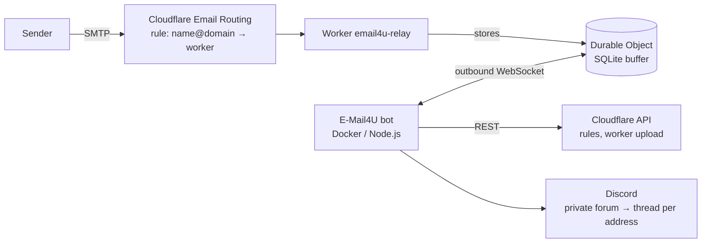

# E-Mail4U

A Discord bot that gives your server members their own email addresses on your domains, powered by
[Cloudflare Email Routing](https://developers.cloudflare.com/email-routing/). Every address gets its own
thread in a private forum, and every mail sent to it shows up there within seconds.

> **Receive only.** Cloudflare Email Routing can only receive mail – sending is not possible.

## Features

- **`/create name domain`** creates a real custom address in your Cloudflare dashboard
  (an Email Routing rule that hands the mail to a worker).
- **Private forum per user** (visible only to them), one forum post per address, mails posted as rich embeds.
- **Domain access control:** the bot owner always has access to every domain. `/perms` grants or revokes
  domains per user – also by user ID for people who haven't joined the server yet, and with an
  "all domains (including future ones)" option.
- **Autocomplete everywhere:** domains filtered by access, name suggestions including random names and an
  availability check.
- **Verification codes** are detected and shown in the push notification, with a button to copy them;
  confirmation links ("Verify email", "Reset password" …) become link buttons.
- **Attachments** are forwarded within Discord's upload limits. Long mails are shortened and the full text is
  attached. The **Original** button returns the `.eml` and an HTML view in which scripts, forms and remote
  content (tracking pixels) are blocked.
- **Per-address controls** in each thread: pause, mute (no pings), note, delete.
- **Spoofing warning** when the DMARC check fails – only Cloudflare's own `Authentication-Results` header is trusted.
- **No public endpoint needed:** the bot connects *outbound* to a relay worker. Mails are buffered in a
  Durable Object while the bot is offline and delivered as soon as it is back.
- **Dashboard sync:** addresses deleted or paused in the Cloudflare dashboard are picked up; rules that point
  to the worker are imported.
- **Catch-all support:** point the catch-all rule to the worker and mail for unknown addresses lands in the owner's forum.
- **Safety:** reserved names (`admin@`, `postmaster@`, `hostmaster@` … – used for certificate validation) are
  owner-only, per-user address limit, `@everyone` inside a mail never pings anyone, optional log channel.

## How it works



1. On startup the bot uploads the relay worker (`email4u-relay`) to your Cloudflare account and enables its
   `workers.dev` route. You don't need `wrangler`.
2. `/create` adds an Email Routing rule *"to = name@domain → send to worker"* and creates the forum thread.
3. The worker streams each incoming mail into a SQLite-backed Durable Object.
4. The bot holds an authenticated WebSocket to the Durable Object, pulls the mails one by one, parses them and
   posts them into the right thread. A mail is only removed from the buffer after Discord accepted it.

Everything runs on the Cloudflare **Workers Free plan**.

## Requirements

- A Discord server where you can add a bot.
- A Cloudflare account with your domain(s), and **Email Routing enabled** on every domain you want to use
  (dashboard → your domain → *Email → Email Routing*). Enabling it replaces existing MX records.
- A **workers.dev subdomain** – open *Workers & Pages* in the dashboard once and Cloudflare creates it.
- **Docker**, or **Node.js ≥ 22.13** (24 recommended).

## Setup

### 1. Discord application

1. Create an application in the [Discord Developer Portal](https://discord.com/developers/applications).
2. *Bot* → **Reset Token** → copy it (`DISCORD_TOKEN`). Optionally turn off *Public Bot*.
   No privileged gateway intents are needed.
3. Invite the bot (replace `YOUR_APPLICATION_ID`, see *General Information*):

   ```
   https://discord.com/oauth2/authorize?client_id=YOUR_APPLICATION_ID&scope=bot+applications.commands&permissions=292057893968
   ```

   The bot needs: View Channels, Manage Channels, Send Messages, Send Messages in Threads, Manage Threads,
   Embed Links, Attach Files, Read Message History and Add Reactions. It also prints this link on startup.
4. Enable *Developer Mode* in Discord, right-click your server → **Copy Server ID** (`DISCORD_GUILD_ID`).

### 2. Cloudflare API token

Dashboard → *My Profile* → *API Tokens* → **Create Token** → *Create Custom Token*:

| Scope   | Permission          | Level | Used for                                   |
|---------|---------------------|-------|--------------------------------------------|
| Account | Workers Scripts     | Edit  | uploading the relay worker, workers.dev route |
| Zone    | Zone                | Read  | listing your domains                       |
| Zone    | Zone Settings       | Read  | showing the Email Routing status           |
| Zone    | Email Routing Rules | Edit  | creating, pausing and deleting addresses   |

Account resources: your account. Zone resources: *All zones* (or just the domains you want to use).

### 3. Configuration

```bash
cp .env.example .env
```

| Variable                | Required | Default         | Description |
|-------------------------|:--------:|-----------------|-------------|
| `DISCORD_TOKEN`         | ✓        |                 | Bot token |
| `DISCORD_GUILD_ID`      | ✓        |                 | ID of your server |
| `CLOUDFLARE_API_TOKEN`  | ✓        |                 | API token from step 2 |
| `CLOUDFLARE_ACCOUNT_ID` |          | auto            | Only needed if the token can access several accounts |
| `OWNER_IDS`             |          | app owner       | Comma-separated user IDs of the bot owners |
| `WORKER_NAME`           |          | `email4u-relay` | Name of the worker created in your account |
| `MAIL_RETENTION_DAYS`   |          | `30`            | How long original mails are kept for the *Original* button (`0` = never stored) |
| `UPLOAD_LIMIT_MB`       |          | auto            | Force the Discord upload limit (default: 20/50/100 MB by boost level) |
| `LOG_LEVEL`             |          | `info`          | `debug`, `info`, `warn` or `error` |
| `TZ`                    |          | `UTC`           | Time zone for log timestamps, e.g. `Europe/Berlin` |
| `DATA_DIR`              |          | `./data`        | Database and stored mails |

### 4. Run

With Docker (recommended):

```bash
docker compose up -d --build
docker compose logs -f
```

Or with Node.js:

```bash
npm ci
npm start
```

A successful start logs `Relay worker "email4u-relay" created`, `Registered slash commands` and
`Relay: connected to the Cloudflare worker`. If something is missing (e.g. the workers.dev subdomain), the bot
stays online in Discord, shows the reason in `/setup` and retries every five minutes.

### 5. In Discord

1. Create a category (e.g. *📬 Mail*) and run `/setup category:📬 Mail` – optionally with `log:#bot-log` and `limit:`.
2. Run `/create name:test domain:your-domain.com` and send a mail to `test@your-domain.com`.
3. Give other people access with `/perms user:@someone domain:your-domain.com`.

## Commands

| Command | Who | Description |
|---------|-----|-------------|
| `/create name domain [note]` | everyone with access | Create an address; a private forum is created on first use |
| `/list [user]` | everyone (owner: any user) | Your addresses with mail count and last mail |
| `/delete address` | owner of the address, bot owner | Delete an address, keep or remove its thread |
| `/domains` | everyone | Domains you can use (owner: all domains, routing status and who has access) |
| `/perms user [domain] [action]` | bot owner | Grant/revoke domain access, or show it when `domain` is empty |
| `/setup [category] [limit] [log] [log_off]` | bot owner | Configure the bot; without options it shows the status |
| `/help` | everyone | Short guide |

`/perms` and `/setup` are only visible to server administrators by default (this can be changed in the server's
*Integrations* settings); the bot checks for the bot owner in any case.

## Data & privacy

- The bot stores its SQLite database and the original mails (`MAIL_RETENTION_DAYS`, default 30 days) in the data
  volume / `DATA_DIR`. Mails that could not be delivered are kept in `data/failed/`.
- The worker keeps mails only until the bot has delivered them (at most 30 days).
- The bot authenticates against the worker with a random secret that is generated on first start.
- Forums are private to their user – but Discord administrators can always see every channel.

## Limits

- Cloudflare: at most 200 routing rules per domain, 25 MiB per mail, addresses up to 90 characters.
- Discord: 20 MiB per file (50/100 MiB with boost level 2/3). Larger attachments are listed but not uploaded.
- Workers Free plan: 10 ms CPU per invocation – extremely large mails might exceed it.
- Run only one instance per worker – a second instance takes over the relay connection.
- With subaddressing enabled in Cloudflare, `name+tag@domain` is delivered to the thread of `name@domain`.

## Troubleshooting

| Problem | Fix |
|---------|-----|
| `no workers.dev subdomain yet` | Open *Workers & Pages* in the Cloudflare dashboard once. |
| TLS handshake errors right after creating the subdomain | Cloudflare is still issuing the certificate – the bot connects on its own after a few minutes. |
| `Email Routing is not enabled for …` | Enable Email Routing for that domain in the dashboard. |
| `/setup` reports missing permissions | Give the bot role the listed permissions (or re-invite it with the link above). |
| Slash commands don't show up | Check `DISCORD_GUILD_ID` and that the bot was invited with the `applications.commands` scope. |

## Development

```bash
npm test             # unit tests (node:test)
npm run test:relay   # runs the real worker locally in wrangler/workerd and tests the relay protocol
```

```
src/
  index.js            startup, Discord client, background jobs
  config.js, db.js    configuration and SQLite storage (node:sqlite)
  cloudflare/         API client, domains & routing rules, worker deployment
  relay/client.js     WebSocket client for the relay (next/ack protocol)
  mail/               parsing, formatting for Discord, code/link detection, delivery, HTML export
  discord/            slash commands, interactions, forums/threads, UI
  services/           access control, address lifecycle, Cloudflare sync
worker/relay.js       Cloudflare worker + Durable Object (uploaded by the bot)
tests/                unit and integration tests
```

## License

[MIT](LICENSE)
